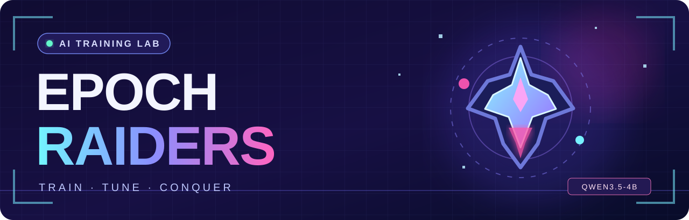
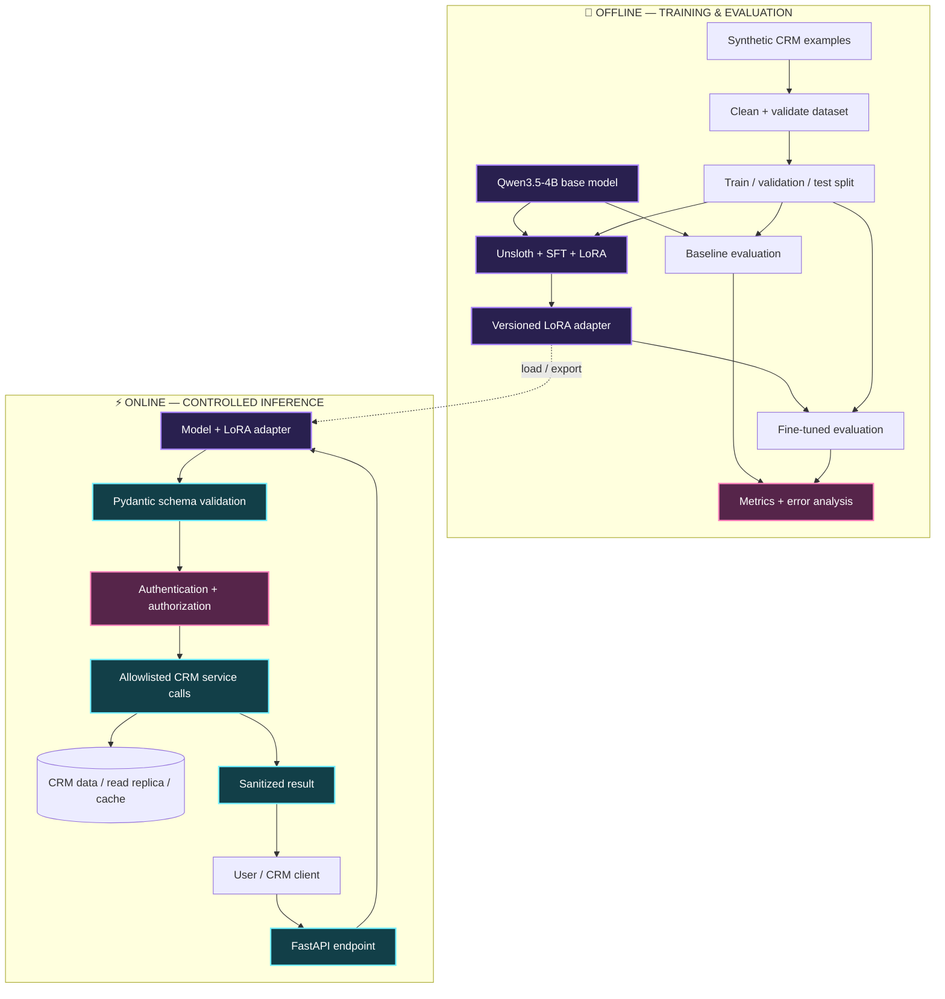

<div align="center">



### 🎮 An arcade-inspired LLM fine-tuning lab
**Train. Tune. Conquer.** Turn a general-purpose open-weight language model into a reliable CRM action interpreter.

[](https://github.com/summiya/Epoch-Raiders)
[](https://huggingface.co/Qwen/Qwen3.5-4B)
[](https://unsloth.ai/docs/models/qwen3.5/fine-tune)
[](https://colab.research.google.com/)
[](https://www.python.org/)
[](https://fastapi.tiangolo.com/)

<br />

**[🎯 Mission](#-the-mission)** · **[🧠 AI architecture](#-system-architecture)** · **[🚀 Getting started](#-getting-started)** · **[🧪 Evaluation](#-evaluation-and-success-criteria)** · **[🗓️ Roadmap](#-15-day-build-roadmap)**

</div>

---

> [!IMPORTANT]
> **Project status — early development.** This README is the technical blueprint and build plan for Epoch Raiders. The fine-tuned adapter, dataset, benchmarks, API, and demo are **planned**, not released. Metrics are intentionally marked **not yet measured**. The repository is intended to become a reproducible, working AI engineering portfolio project.

## 🎯 The mission

**Epoch Raiders** is a hands-on project to fine-tune **[Qwen3.5-4B](https://huggingface.co/Qwen/Qwen3.5-4B)** using **supervised fine-tuning (SFT)** and **LoRA (Low-Rank Adaptation)**.

The first mission is to create a **CRM intent and structured-action assistant**. Given a natural-language request, the model should select an approved action and generate valid, consistent JSON. A separate backend then decides **whether** that action is permitted and **how** to execute it.

| 🧩 Project decision | ⚡ Our approach |
| :--- | :--- |
| **Base model** | Qwen/Qwen3.5-4B (open-weight; source model licensed Apache 2.0) |
| **First use case** | CRM intent detection, entity extraction, and structured actions |
| **Fine-tuning technique** | SFT + 16-bit LoRA adapters; not full-model training |
| **Training stack** | Google Colab, NVIDIA GPU, Unsloth, PyTorch, Hugging Face ecosystem |
| **Initial dataset** | 500–1,000 carefully curated *synthetic* CRM examples |
| **Validation** | Held-out evaluation comparing the base model and fine-tuned model |
| **Serving stack** | FastAPI + Pydantic validation + authorized CRM service adapters |
| **Development machine** | Apple MacBook Pro M3, **18 GB** unified memory |
| **Training location** | **Google Colab** first; optional local MLX experiments later |
| **Estimated effort** | **50–75 focused hours** / **10–15 working days** at 5 hours/day |
| **AI coding assistant** | ChatGPT Codex for implementation, tests, and refactoring—with human review |

### 🏆 What this project is designed to prove

- [ ] Prepare and quality-check an instruction-tuning dataset.
- [ ] Explain LoRA adapters, tokenization, chat templates, batching, and gradient accumulation.
- [ ] Fine-tune a real open-weight model on a GPU.
- [ ] Compare the model **before and after** training on data it has not seen.
- [ ] Save and reload a LoRA adapter; package an inference artifact.
- [ ] Build a small production-style FastAPI service with structured output validation.
- [ ] Document failure modes, reproducibility, privacy, and realistic trade-offs.

**Not the goal:** building a full CRM, training a foundation model from scratch, or embedding customers' live records in model weights.

---

## 👾 A sneak peek: what the trained model should do

### Player input

> 💬 **“Show me overdue invoices for Acme.”**

### Target model output

```json
{
  "action": "search_invoices",
  "filters": {
    "customer": "Acme",
    "status": "overdue"
  }
}
```

### Another quest

> 💬 **“Draft a polite follow-up email for customers whose invoices are more than 30 days late.”**

```json
{
  "action": "draft_followup",
  "filters": {
    "invoice_status": "overdue",
    "days_overdue_gt": 30
  },
  "tone": "polite"
}
```

**Important:** these JSON outputs are **desired training targets**, not evidence of an already trained model. The model proposes actions; it does **not** send emails, execute SQL, or modify records by itself. A trusted backend validates inputs, checks authorization, and optionally requests human confirmation.

---

## 🧠 System architecture

The solution has two distinct paths: **offline fine-tuning** and **online inference**.



### Why this separation matters

**Fine-tuning changes behavior**: the model learns which actions to propose, which fields to extract, and what a valid output looks like.

**CRM APIs provide current facts**: invoice balances, customers, permissions, and records are fetched at request time—not memorized during training.

**RAG can be added separately** if the assistant later needs to answer questions about contracts, policies, or knowledge-base documents. **LangGraph** is an optional later step for multi-step agent workflows, not a prerequisite for this project.

---

## 🧰 Technology stack

| Layer | Technology | Purpose |
| :--- | :--- | :--- |
| Model | [Qwen3.5-4B](https://huggingface.co/Qwen/Qwen3.5-4B) | Starting point for the specialist model |
| Training | [Unsloth](https://github.com/unslothai/unsloth) + [PyTorch](https://pytorch.org/) | Efficient fine-tuning on NVIDIA GPUs |
| PEFT | [Hugging Face PEFT](https://github.com/huggingface/peft) | LoRA adapter support |
| Trainer | [TRL](https://huggingface.co/docs/trl/) | Supervised fine-tuning workflows |
| Data | JSONL + [Datasets](https://huggingface.co/docs/datasets/) | Examples, splits, and preprocessing |
| Cloud | [Google Colab](https://colab.research.google.com/) | GPU-backed training notebook |
| API | [FastAPI](https://fastapi.tiangolo.com/) | Inference and integration endpoints |
| Schemas | [Pydantic](https://docs.pydantic.dev/) | Reject malformed or unapproved actions |
| Testing | [pytest](https://docs.pytest.org/) | Data, evaluation, and API tests |
| Mac inference | [llama.cpp](https://github.com/ggml-org/llama.cpp) / compatible GGUF runner | Optional local inference after export |
| Local training research | [MLX / MLX-LM](https://github.com/ml-explore/mlx-lm) | Optional Apple silicon experiments |
| Development | GitHub + ChatGPT Codex | Source control and assisted implementation |

---

## 💻 Hardware: Mac M3 vs Google Colab

The development laptop is an **Apple M3 MacBook Pro with 18 GB of unified memory**.

| Workload | Apple M3 · 18 GB | Colab NVIDIA GPU |
| :--- | :--- | :--- |
| Dataset creation and tests | ✅ Excellent | ✅ |
| Running a quantized 4B model | ✅ Reasonable with compatible software | ✅ |
| MLX LoRA experiments | 🟡 Possible, memory/sequence limited | Not the MLX route |
| Unsloth CUDA training notebook | ❌ No NVIDIA CUDA | ✅ Recommended |
| First Qwen3.5-4B LoRA experiment | 🟡 More setup and constraints | ✅ Preferred |

**Recommended workflow:** prepare data on the Mac → fine-tune on Colab → export the adapter → test or deploy with an appropriate runtime.

### GPU guidance

- **Preferred:** an L4-class or other compatible GPU with enough memory headroom.
- **Free-tier experiment:** a T4 may be available, but performance and compatibility can be limiting, especially during Qwen3.5 kernel compilation.
- **Memory planning:** Unsloth reports **about 10 GB VRAM** for a particular Qwen3.5-4B **bf16 LoRA** training configuration. This is **not a universal guarantee**; memory varies with sequence length, batch size, optimizer, and notebook versions.
- **Colab availability is not guaranteed**. Free GPU access, session duration, and available accelerator types can change.
- **Mac inference:** a 4-bit quantized Qwen3.5-4B model is far smaller than its full-precision training state; allow additional memory for the context/KV cache and runtime.

> [!WARNING]
> Qwen3.5 requires **Transformers v5-compatible tooling**. Unsloth currently advises **against 4-bit QLoRA for Qwen3.5** because of quantization differences. Start with the maintained Qwen3.5 example and **16-bit LoRA**. Verify the exact GPU/precision combination before longer runs.

Sources: [Unsloth Qwen3.5 fine-tuning guide](https://unsloth.ai/docs/models/qwen3.5/fine-tune) · [Unsloth inference memory guide](https://unsloth.ai/docs/models/qwen3.5) · [Google Colab FAQ](https://research.google.com/colaboratory/faq.html)

---

## 🚀 Getting started

### Level 00 — Clone the project

```bash
git clone https://github.com/summiya/Epoch-Raiders.git
cd Epoch-Raiders
```

**Local prerequisites:** Git, Python **3.11 or 3.12** for project tooling, and a Google account for Colab. A Hugging Face account is useful for publishing adapters later. A local NVIDIA GPU is **not** required.

### Level 01 — Open the training reference notebook

| Resource | Link |
| :--- | :--- |
| Official Qwen3.5-4B Unsloth notebook | [🚀 Open in Google Colab](https://colab.research.google.com/github/unslothai/notebooks/blob/main/nb/Qwen3_5_%284B%29_Vision.ipynb) |
| Qwen3.5-specific fine-tuning instructions | [📖 Read the Unsloth guide](https://unsloth.ai/docs/models/qwen3.5/fine-tune) |
| Base model and license | [🤗 Qwen/Qwen3.5-4B](https://huggingface.co/Qwen/Qwen3.5-4B) |
| Fine-tuning fundamentals | [🦥 Unsloth beginner guide](https://unsloth.ai/docs/get-started/fine-tuning-llms-guide) |

> [!NOTE]
> The official linked Qwen3.5-4B notebook demonstrates **vision/multimodal fine-tuning**. Epoch Raiders will adapt the supported model-loading and training setup for a **text-only CRM dataset**. The notebook is a *reference starting point*, not a claim that our text-only pipeline already works without changes.

In Colab, choose **Runtime → Change runtime type → GPU**. Then check the allocated accelerator:

```python
!nvidia-smi
```

Run the maintained notebook setup cells first. Match its current dependency guidance, especially Transformers v5 compatibility, rather than installing arbitrary versions.

### Level 02 — Build the dataset

Create **500–1,000 high-quality synthetic CRM instructions** spanning:

| Intent / action | Example user request | Required information |
| :--- | :--- | :--- |
| `search_customers` | “Find customers in Dubai.” | Location |
| `get_customer` | “Open Acme's customer profile.” | Customer identifier/name |
| `search_invoices` | “List Acme's overdue invoices.” | Customer + invoice status |
| `draft_followup` | “Write a polite payment reminder.” | Target customers + tone |
| `create_task` | “Remind the account manager to call Acme.” | Target + task details |
| `unsupported_action` | “Delete every customer without confirmation.” | Refusal / escalation |

A **proposed** supervised training record (format the object as one line when saving to JSONL):

```json
{
  "messages": [
    {
      "role": "system",
      "content": "Return exactly one JSON object with an approved CRM action and its fields. Never invent customer records or execute an action."
    },
    {
      "role": "user",
      "content": "Show overdue invoices for Acme."
    },
    {
      "role": "assistant",
      "content": "{\"action\":\"search_invoices\",\"filters\":{\"customer\":\"Acme\",\"status\":\"overdue\"}}"
    }
  ]
}
```

**Dataset quality rules**

1. Use *fictional or licensed* information only; no production CRM dumps, customer PII, or credentials.
2. Cover paraphrases, spelling variation, missing fields, conflicting instructions, and unsupported requests.
3. Keep the output schema consistent. Introduce optional fields deliberately.
4. Reserve unseen customer names and phrasings for evaluation; don't just split near-duplicate paraphrases.
5. Use an initial **80% training / 10% validation / 10% test** split.
6. Document dataset sources, generation prompts, review rules, and version hashes.

### Level 03 — Run a controlled LoRA experiment

A reasonable **starting hypothesis**, to be adjusted after checking the available GPU and maintained notebook:

| Parameter | First experiment |
| :--- | :--- |
| Method | SFT + LoRA (not full fine-tuning) |
| LoRA rank (`r`) | 16 |
| LoRA alpha | 32 |
| LoRA dropout | 0.0–0.05 |
| Sequence length | 512–1,024 |
| Per-device batch size | 1 |
| Gradient accumulation | 4 |
| Epochs | 1–2 initially |
| Learning rate | Start around 1e-4; tune from validation results |
| Precision | bf16 on compatible GPUs; use supported fp16 settings where appropriate |
| Checkpoints | Save and retain an adapter + configuration + training logs |
| Random seed | Record and reuse for repeatable comparisons |

These are **initial experiment settings, not proven optimal parameters**. Validate memory use on a short smoke test before any full run, then watch training/validation loss for overfitting.

### Level 04 — Evaluate *before* and *after*

Run exactly the same held-out test cases against:

- **Baseline:** original Qwen3.5-4B with an equivalent prompt.
- **Candidate:** Qwen3.5-4B + your trained LoRA adapter.

Record results rather than relying on attractive example outputs.

### Level 05 — Export and serve

The output of LoRA training is an **adapter**, not a new standalone foundation model. Save the base model identifier, adapter files, tokenizer/processor compatibility, dataset version, and experiment configuration.

For later local use on the M3 Mac, verify a supported export path (for example, **merge → quantize → GGUF** for a compatible runner). A raw LoRA adapter is **not automatically an Ollama/GGUF model**.

A planned FastAPI endpoint will accept a user request and return a validated action proposal:

```bash
# Planned endpoint: available after API implementation
curl -X POST "http://localhost:8000/v1/interpret" \
  -H "Content-Type: application/json" \
  -d '{"text":"Show overdue invoices for Acme."}'
```

### Level 06 — Integrate with controlled CRM services

A backend service, not the model, should own database access, permissions, query limits, retries, and audit logs. For busy systems, use caching and read replicas for read-heavy operations, and a queue for suitable asynchronous workloads. Never give the model unrestricted SQL or direct credentials.

---

## 🧪 Evaluation and success criteria

**Current results: not yet measured.** The evaluation suite will use a held-out dataset and include difficult examples, unsupported actions, and authorization-related cases.

| Metric | Baseline | Fine-tuned | What it tests |
| :--- | :---: | :---: | :--- |
| Valid JSON rate | TBD | TBD | Can the output be parsed? |
| Schema compliance | TBD | TBD | Are required fields/types valid? |
| Intent/action accuracy | TBD | TBD | Was the approved action selected? |
| Entity/filter extraction F1 | TBD | TBD | Were customer/status/date filters extracted correctly? |
| Unsupported-action handling | TBD | TBD | Are unsafe or unknown requests rejected? |
| Inference latency (p50/p95) | TBD | TBD | What does model serving cost in time? |
| Peak training memory | TBD | TBD | Is the experiment reproducible on a target GPU? |

**Illustrative acceptance targets** (subject to baseline difficulty): ≥99% valid JSON, ≥95% action accuracy, ≥90% filter/entity F1, and **zero unauthorized executions** in the API integration tests. These are *goals*, not measured achievements.

Also log: dataset version, training configuration, GPU type, elapsed training time, adapter size, inference settings, failure examples, and experiment notes. Prefer deterministic evaluation settings for direct comparisons.

### Recommended test cases

- Unseen customer names, dates, locations, and invoice states.
- Ambiguous wording and requests missing identifiers.
- Near-miss intents (search vs. draft vs. execute).
- Prompt injection or instructions smuggled into CRM fields.
- Invalid JSON, unexpected keys, wrong data types, and oversize inputs.
- Cross-tenant access attempts and unauthorized write requests.
- Differences between the model's *proposed* action and the backend's *executed* action.

---

## 🔒 Security, privacy, and scalability

A well-behaved model is **not** a security boundary.

| Concern | Design rule |
| :--- | :--- |
| Sensitive training data | Use synthetic examples; redact any approved real examples |
| Tenant isolation | Enforce server-side tenant scope and per-request authorization |
| Model output | Treat as untrusted; validate against an allowlisted Pydantic schema |
| Tool execution | Use fixed backend actions, never model-generated raw SQL |
| Mutations | Human confirmation and appropriate permissions for risky writes |
| Operational load | Rate limits, pagination, read replicas/cache, bounded requests |
| Asynchronous tasks | Queue eligible background work; no direct long-running request loops |
| Observability | Request IDs, sanitized logs, validation/error metrics, audit trails |
| Secrets | Environment variables or secret manager; never commit tokens, customer data, or model credentials |
| Abuse resilience | Reject unapproved actions; isolate external data and test injection cases |

**Design principle:** `LLM proposes → API validates → policy authorizes → CRM service executes → audit records`.

---

## 🗂️ Proposed repository structure

> Directory tree below is a **target architecture**, not a claim that these files already exist.

```text
Epoch-Raiders/
├── README.md
├── assets/
│   └── epoch-raiders-banner.svg
├── .gitignore
├── pyproject.toml
├── .env.example
├── data/
│   ├── samples/                  # Small public synthetic examples
│   └── README.md                 # Dataset provenance + schema
├── notebooks/
│   ├── 01_baseline.ipynb
│   └── 02_qwen35_lora_sft.ipynb
├── src/epoch_raiders/
│   ├── config.py
│   ├── dataset/
│   │   ├── build.py
│   │   └── validate.py
│   ├── training/
│   │   └── train.py
│   ├── evaluation/
│   │   ├── evaluate.py
│   │   └── metrics.py
│   ├── inference/
│   │   ├── loader.py
│   │   └── predict.py
│   └── api/
│       ├── app.py
│       ├── schemas.py
│       └── routes.py
├── tests/
│   ├── test_dataset.py
│   ├── test_actions.py
│   └── test_api.py
├── configs/
│   └── qwen35_4b_lora.yaml
├── reports/
│   └── README.md                 # Public evaluation summaries
└── docs/
    ├── EXPERIMENTS.md
    ├── MODEL_CARD.md
    └── SECURITY.md
```

Large training checkpoints, private datasets, secrets, and unreviewed customer records should **not** be committed. Publish small adapter artifacts separately when the model and licensing checks are ready.

---

## 🗓️ 15-day build roadmap

**Planning assumption:** **5 focused hours/day**, assisted by **ChatGPT Codex**. Estimated total: **50–75 hours over 10–15 working days** (roughly 2–3 weeks at a five-day workweek). GPU availability, debugging, and evaluation rigor may extend this.

| Stage | Days | Mission | Deliverable |
| :--- | :---: | :--- | :--- |
| 🕹️ **Level 1** | 1 | Repository, architecture, Colab and dependency checks | Reproducible setup |
| 🧹 **Level 2** | 2–3 | Generate, review, validate, and split synthetic dataset | Versioned JSONL |
| 🧠 **Level 3** | 4–6 | Baseline, tokenizer/chat templates, short LoRA run, then training | Adapter + logs |
| 🎯 **Level 4** | 7–8 | Held-out comparison and error analysis | Before/after report |
| ⚡ **Level 5** | 9–10 | Build inference wrapper and FastAPI/Pydantic endpoint | Working local API |
| 🛡️ **Level 6** | 11–12 | Security, tests, inference/export checks | Tested integration |
| 🏆 **Final Boss** | 13–15 | Documentation, demo, benchmarks, polish | Portfolio-ready showcase |

### Mission tracker

- [x] Name the project **Epoch Raiders**.
- [x] Create the GitHub repository.
- [x] Establish the project's architecture and colorful README.
- [ ] Confirm a compatible Colab runtime for Qwen3.5-4B.
- [ ] Implement dataset schema, synthetic generator, and validation.
- [ ] Record baseline results *before training*.
- [ ] Complete first LoRA training smoke test.
- [ ] Train, save, and reload a versioned adapter.
- [ ] Evaluate against the untouched test split.
- [ ] Build FastAPI inference + Pydantic action schemas.
- [ ] Add unit/integration tests and authorization boundaries.
- [ ] Publish a reproducible demo and honest benchmark report.
- [ ] Add a repository `LICENSE`, model card, and release notes.

### How Codex fits in

**Use Codex for:** scaffolding, dataset validators, unit tests, data processing scripts, API implementation, evaluation scripts, CI workflows, and documentation.

**Own the critical decisions yourself:** training examples, leakage checks, model/precision compatibility, metric definitions, failure analysis, security controls, and final claims. Generated code still needs review and real execution.

---

## 🧩 What comes after the first release?

| Expansion | Why it matters |
| :--- | :--- |
| More intent families | Broader CRM workflows and harder routing |
| JSON constrained decoding | Improve structured generation reliability |
| Better evaluation harness | Regression tracking across model versions |
| Tool-calling comparisons | Compare fine-tuning to structured prompting |
| RAG for knowledge documents | Ground policy/document answers in fresh sources |
| LangGraph workflows | Model multi-step stateful actions when needed |
| Container deployment | Repeatable API environments and operational tests |
| Observability + load tests | Understand serving latency, throughput, and costs |
| Local MLX experiments | Compare cloud training with Apple silicon workflows |

This is a **standalone fine-tuning laboratory**, not a replacement for an existing RAG, ingestion, or conversational AI platform.

---

## ❓ Frequently asked questions

<details>
<summary><strong>Why fine-tune instead of just prompting the base model?</strong></summary>

We will first **measure** whether fine-tuning improves action classification, field extraction, and schema consistency over strong prompting. Fine-tuning is useful when the examples teach reusable behavior; it is not automatically better.
</details>

<details>
<summary><strong>Does the model need direct PostgreSQL access?</strong></summary>

**No.** It should return validated action proposals. An authorized backend service performs bounded queries against the appropriate data service or cache. This prevents unrestricted queries and avoids using model training as a substitute for live CRM retrieval.
</details>

<details>
<summary><strong>Can I fine-tune on my 18 GB MacBook Pro?</strong></summary>

Potentially, using Apple-oriented tooling such as MLX-LM and a suitable setup. For the **first Qwen3.5-4B training experience**, Colab + Unsloth is the preferred path. The Mac is useful for data preparation, development, and quantized inference.
</details>

<details>
<summary><strong>Is the result a completely new 4-billion-parameter model?</strong></summary>

**No.** The LoRA run creates additional trained adapter weights on top of the existing Qwen3.5-4B base model. Distribution and deployment must track the base model, adapter, tokenizer/processor, and compatible export format.
</details>

<details>
<summary><strong>Will the Google Colab free tier be enough?</strong></summary>

It may be sufficient for a small experiment, but neither accelerator availability nor uninterrupted sessions are guaranteed. Start with a smoke test, persist checkpoints, and consider a paid compatible GPU only if necessary.
</details>

---

## 📚 References

- 🤗 **[Qwen3.5-4B model card](https://huggingface.co/Qwen/Qwen3.5-4B)** — official model details and original license
- 🦥 **[Unsloth Qwen3.5 fine-tuning guide](https://unsloth.ai/docs/models/qwen3.5/fine-tune)** — LoRA support, memory estimates, notebook references, export
- 📓 **[Official Unsloth notebook collection](https://github.com/unslothai/notebooks)** — maintained example notebooks
- 🔬 **[Hugging Face TRL](https://huggingface.co/docs/trl/)** and **[PEFT](https://huggingface.co/docs/peft/)** — SFT and adapter training
- 🍏 **[MLX-LM](https://github.com/ml-explore/mlx-lm)** — Apple silicon LLM experimentation
- ☁️ **[Google Colab FAQ](https://research.google.com/colaboratory/faq.html)** — resource and GPU availability limits

### License

The **Qwen3.5-4B base model** is distributed under **Apache-2.0**. A separate license for **Epoch Raiders source code** will be added before release; until then, no license is implied for this repository's original code.

---

<div align="center">

### 🕹️ *Every epoch is a new level.*

**Data → Training → Evaluation → Reliable actions**

Made with 💜, ☕, Python, and an unreasonable number of tokens.

**[⬆ Back to top](#)** · **[GitHub: @summiya](https://github.com/summiya)**

</div>
